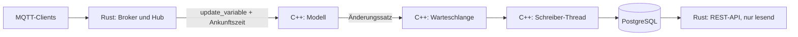
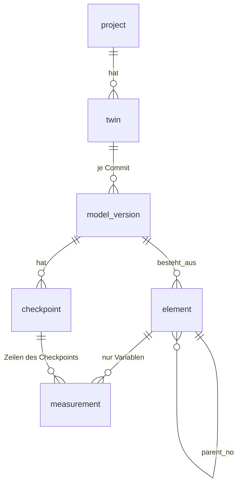

# Plan: Historie aus dem C++-Kern, Lesezugriff über Rust-REST-API

Stand: 2026-11-19. Noch nichts umgesetzt.

## 1. Entscheidungen

| Thema | Entscheidung |
|---|---|
| Schreiber | Der C++-Kern schreibt die Datenbank. Rust schreibt nicht mehr. |
| Leser | Eine neue REST-API im Rust-Server liest, mit einer Datenbankrolle, die nur `SELECT` darf. |
| Speicherform | Änderungsprotokoll plus Checkpoints (vollständiger Zustand beim Laden und in festem Abstand). |
| Rust-Recorder | `DTServerRust/src/history` wird entfernt. Die bisherigen Daten in `measurement` werden verworfen. |
| Neustart | Beim erneuten Laden gilt der letzte gespeicherte Zustand desselben Commits. Ein neuer Commit startet mit den Initialwerten. |
| Versionierung | Die Commit-ID der DigitalTwin-Entity (`referencedCommit`) wird je Modellversion gespeichert. |
| Schema-Hoheit | Der C++-Kern legt das Schema an und pflegt Partitionen und Retention. Nur eine Seite ändert das Schema. |

Langfristig soll die Software vollständig nach Rust portiert werden können. Deshalb liegt die gesamte
Datenlogik im Kern und nicht in der Brücke: Bei einer Portierung wandert sie als Ganzes mit.

## 2. Datenfluss



Ein Aufruf von `update_variable` erzeugt genau einen Änderungssatz: die vom Client gesetzte Variable und
alle Variablen, die das Modell dadurch mitändert (verknüpfte Variablen). Alle Zeilen eines Satzes tragen
dieselbe Änderungsnummer. Damit gibt es keine Zwischenzustände, die es im Modell nie gab.

## 3. Schema



```sql
CREATE TABLE project (
    project_id  uuid        PRIMARY KEY,
    name        text,
    first_seen  timestamptz NOT NULL DEFAULT now()
);

CREATE TABLE twin (
    twin_no     integer     GENERATED ALWAYS AS IDENTITY PRIMARY KEY,
    twin_id     uuid        NOT NULL UNIQUE,
    project_id  uuid        NOT NULL REFERENCES project,
    name        text        NOT NULL,
    first_seen  timestamptz NOT NULL DEFAULT now(),
    last_seen   timestamptz NOT NULL DEFAULT now()
);

-- Eine Zeile je geladenem Commit eines Twins.
CREATE TABLE model_version (
    version_no  integer     GENERATED ALWAYS AS IDENTITY PRIMARY KEY,
    twin_no     integer     NOT NULL REFERENCES twin,
    commit_id   uuid        NOT NULL,
    first_loaded timestamptz NOT NULL DEFAULT now(),
    last_loaded  timestamptz NOT NULL DEFAULT now(),
    UNIQUE (twin_no, commit_id)
);

-- Der Modellbaum eines Commits. kind: 1 Package, 2 Component, 3 Port,
-- 4 Measurable, 5 Controllable, 6 Attribute. value_type nur bei Variablen (kind >= 4).
CREATE TABLE element (
    element_no  integer     GENERATED ALWAYS AS IDENTITY PRIMARY KEY,
    version_no  integer     NOT NULL REFERENCES model_version,
    parent_no   integer     REFERENCES element,
    kind        smallint    NOT NULL,
    name        text        NOT NULL,
    path        text        NOT NULL,
    value_type  smallint,
    UNIQUE (version_no, path)
);

CREATE TABLE checkpoint (
    checkpoint_no bigint     GENERATED ALWAYS AS IDENTITY PRIMARY KEY,
    version_no  integer     NOT NULL REFERENCES model_version,
    taken_at    timestamptz NOT NULL,
    reason      smallint    NOT NULL,   -- 1 Laden, 2 Intervall, 3 neue Partition, 4 nach Datenverlust, 5 Beenden
    variables   integer     NOT NULL
);
CREATE INDEX checkpoint_version_taken_idx ON checkpoint (version_no, taken_at DESC);

-- Änderungen und Checkpoint-Zeilen in einer Tabelle, monatlich partitioniert.
-- source: 1 Client, 2 vom Modell abgeleitet, 3 Checkpoint.
CREATE TABLE measurement (
    element_no    integer          NOT NULL,
    change_no     bigint           NOT NULL,
    received_at   timestamptz      NOT NULL,
    ts            timestamptz      NOT NULL,
    source        smallint         NOT NULL,
    checkpoint_no bigint,
    value_num     double precision,
    value_text    text,
    value_json    jsonb
) PARTITION BY RANGE (received_at);
CREATE INDEX measurement_element_received_idx ON measurement (element_no, received_at DESC, change_no DESC);
```

Anmerkungen:

- **Elemente je Commit.** Der Baum darf sich zwischen Commits beliebig ändern. Dieselbe Variable hat in zwei
  Commits zwei `element_no`; über `path` lässt sie sich verbinden.
- **Checkpoints als Zeilen.** Ein Checkpoint schreibt jede Variable als normale Zeile mit gesetztem
  `checkpoint_no`. Zustand und Zeitreihe lassen sich so mit derselben Tabelle und ohne JSON-Dekodierung
  abfragen.
- **Zeilenbreite.** Statt zwei UUIDs und dem Pfad als Text steht je Zeile eine 4-Byte-ID. `value_type` steht
  nur noch am Element.
- **Partitionsschlüssel ist `received_at`**, nicht mehr die Client-Zeit `ts`. Die Ankunftszeit ist monoton und
  kommt vom Broker.
- **Kein Fremdschlüssel von `measurement`** auf `element`, damit das Einfügen großer Mengen schnell bleibt.

Zustand eines Twins zum Zeitpunkt `:t`:

```sql
WITH cp AS (
    SELECT checkpoint_no, taken_at FROM checkpoint
    WHERE version_no = :version AND taken_at <= :t
    ORDER BY taken_at DESC LIMIT 1
)
SELECT DISTINCT ON (m.element_no) m.element_no, m.value_num, m.value_text, m.value_json, m.received_at
FROM measurement m, cp
WHERE m.element_no IN (SELECT element_no FROM element WHERE version_no = :version)
  AND m.received_at >= cp.taken_at AND m.received_at <= :t
ORDER BY m.element_no, m.received_at DESC, m.change_no DESC;
```

## 4. C++-Kern

### 4.1 Modell (`DigitalTwinLib`)

- **Baum herausgeben.** Neue Methode, die Packages, Components, Ports und alle Variablen (Measurables,
  Controllables und Attributes) mit Pfad, Art und Werttyp liefert. Heute liefert `getAllMQTTVariables` nur
  Controllables und Measurables.
- **Änderungen melden.** `IVariable` bekommt eine Meldung bei jeder Wertänderung, auch bei
  `setValueWithoutPropagation`, über das verknüpfte Variablen heute still geändert werden. Betroffen sind alle
  Variablenklassen unter `Model/Entities/Variables`.
- **Änderungssatz.** `updateVariable` sammelt die gemeldeten Variablen und übergibt sie als einen Satz an eine
  Schnittstelle `IStateSink`. Das Modell kennt die Datenbank nicht.
- **Zustand setzen.** Neue Methode, die einen gespeicherten Zustand ohne Weitergabe in die Variablen schreibt
  (für den Neustart).

### 4.2 Speicher (neue Bibliothek, z. B. `DigitalTwinStore`)

Eigene Bibliothek, damit der Qt-Client `libpqxx` nicht mitlinken muss.

- **Schema.** SQL eingebettet, beim Start unter einer Advisory-Sperre angewendet, mit Versionstabelle.
- **Schreiber.** Begrenzte Warteschlange und ein eigener Thread. Einfügen gebündelt per `COPY`
  (`pqxx::stream_to`). Wiederholung mit wachsender Wartezeit bei Verbindungsfehlern.
- **Volle Warteschlange.** Sätze werden verworfen und gezählt. Danach wird ein Checkpoint erzwungen, sodass
  die Lücke begrenzt bleibt.
- **Checkpoints.** Beim Laden, in festem Abstand, beim ersten Schreiben in eine neue Monatspartition, nach
  Datenverlust und beim Beenden. Der Zustand wird unter der Modellsperre kopiert und außerhalb geschrieben.
- **Partitionen und Retention.** Monatspartitionen für den aktuellen und den nächsten Monat. Retention löscht
  ganze Partitionen; weil jede Partition mit einem Checkpoint beginnt, bleibt der Zustand rekonstruierbar.
- **Zähler.** Geschrieben, verworfen, Wiederholungen, Checkpoints.

### 4.3 Laden eines Twins

1. Modell aus dem Commit bauen (wie heute).
2. `project`, `twin` und `model_version` anlegen oder aktualisieren.
3. Neuer Commit: Baum in `element` schreiben. Bekannter Commit: `element_no` je Pfad laden.
4. Bekannter Commit: letzten Zustand lesen und ins Modell setzen.
5. Checkpoint mit Grund „Laden" schreiben.
6. Elemente an Rust zurückgeben. Die veröffentlichten Startwerte sind damit die wiederhergestellten Werte.

## 5. Brücke (`ffi/dt_facade`, `src/twin/ffi.rs`)

| Aufruf | Änderung |
|---|---|
| `facade_store_configure(url, retention_days, checkpoint_interval_s, queue_capacity)` | neu, einmal beim Start |
| `facade_update_variable(twin_id, path, payload_json, received_at_ms)` | zusätzliches Feld für die Ankunftszeit |
| `facade_store_stats()` | neu, Zähler für die Statistikzeile in Rust |
| `facade_store_shutdown(timeout_ms)` | neu, schreibt die Warteschlange leer und einen letzten Checkpoint |
| `facade_load_twin` | Signatur unverändert, schreibt intern Version und Baum |

Die Datenbank-URL kann ein Passwort enthalten und darf auf keiner Seite geloggt werden.

## 6. Rust-Server

- **Entfernen:** `src/history`, `migrations/0001_init.sql`, `tests/history_db.rs`, `TwinObserver` und die
  Verdrahtung in `main.rs`. `sqlx` bleibt für das Lesen, ohne das Feature `migrate`.
- **Konfiguration:** `run.history.*` bleibt, wird aber an die Fassade übergeben. `batch_size` und
  `flush_interval_ms` gehen mit, neu ist `checkpoint_interval_s`.
- **Weiterleitung:** `forward_variable_updates` gibt die Ankunftszeit der Nachricht mit.
- **REST-API (neu, nur lesend):**

| Route | Inhalt |
|---|---|
| `GET /projects` | Projekte |
| `GET /projects/{project_id}/twins` | Twins eines Projekts |
| `GET /twins/{twin_id}/versions` | geladene Commits |
| `GET /twins/{twin_id}/elements?commit=` | Baum eines Commits |
| `GET /twins/{twin_id}/state?at=&path=` | Zustand zum Zeitpunkt, optional nur ein Teilbaum |
| `GET /twins/{twin_id}/series?path=&from=&to=&limit=` | Zeitreihe einer Variable |

## 7. Was sich gegenüber heute ändert

- **Ohne geladenes Modell wird nichts aufgezeichnet.** Heute speichert der Recorder nach einem Neustart schon
  vor dem nächsten `connectToTwin`. Künftig beginnt die Aufzeichnung mit dem Laden.
- **Nur Pfade des Modells werden gespeichert.** Heute speichert der Recorder jeden Pfad unter dem Twin-Namen.
- **Ohne das Feature `ffi` gibt es keine Historie.**
- **Verlorene Hub-Nachrichten fehlen auch im Modell.** Das gilt schon heute; es wird nur sichtbarer, weil das
  Modell die einzige Quelle ist.

## 8. Reihenfolge

| Phase | Inhalt | Prüfung |
|---|---|---|
| 0 | Fehler in `twin/mod.rs` beheben: Die Aufgaben für `registerFunction` und Variablen-Updates liegen unter demselben Schlüssel, die zweite bricht die erste ab. | Rust-Test |
| 1 | Modell: Baum herausgeben, Änderungen melden, Änderungssatz, Zustand setzen. Ohne Datenbank. | GTest in `DigitalTwinLib/tests` |
| 2 | `DigitalTwinStore`: Schema, Schreiber, Partitionen, Checkpoints, Retention. | GTest gegen PostgreSQL |
| 3 | Brücke verdrahten, Wiederherstellung beim Laden, Rust-Recorder entfernen. | `tests/ffi_backend.rs`, Live-Test |
| 4 | REST-API in Rust. | Integrationstests gegen PostgreSQL |
| 5 | README, Konfigurationsbeispiel, CI. | – |

Phase 0 ist unabhängig. Phase 4 kann nach Phase 2 parallel zu Phase 3 laufen, weil sie nur das Schema braucht.

## 9. Risiken und offene Punkte

1. **Linken von `libpqxx` in die Rust-Binärdatei.** `libpqxx` braucht `libpq` und OpenSSL. `ffi/link_plan.rs`
   muss erweitert werden; unter Windows ist das nach den bisherigen Erfahrungen der unsicherste Teil. Vor
   Phase 2 mit einem Minimalbeispiel prüfen.
2. **Port-Variablen.** Ob Ports eigene Werte tragen, die zum Zustand gehören, ist nicht geprüft.
3. **Werttypen.** `Natural`, `Positive` und `ScalarQuantities` brauchen eine Zuordnung zu `value_type`.
4. **Dauer eines Checkpoints.** Das Kopieren des Zustands hält die Modellsperre. Bei sehr großen Modellen
   messen und den Abstand danach wählen.
5. **Zugriffsschutz der REST-API.** Bisher gibt es im Rust-Server keine HTTP-Schnittstelle und kein Konzept
   dafür.
6. **Zeit der abgeleiteten Werte.** Vorschlag: `ts` der auslösenden Nachricht übernehmen.
7. **Spätere Portierung nach Rust.** Der gelöschte Rust-Recorder bleibt in der Git-Historie; die Logik für
   Partitionen und Wiederholungen lässt sich dann wiederverwenden.

## 10. Umsetzungsstand (2026-11-20)

Phasen 0 bis 5 sind im Arbeitsverzeichnis umgesetzt, nicht committet.

Abweichungen vom Plan oben:

- **Schema:** maßgeblich ist `DigitalTwinStore/sql/0001_schema.sql`. Gegenüber Abschnitt 3 neu: die Sequenz
  `measurement_change_no_seq` (Blöcke von 1000) und die Spalte `checkpoint.change_no`.
- **Zustandsabfrage:** Die untere Grenze ist zusätzlich `change_no >= checkpoint.change_no`. Ohne Angabe eines
  Commits bestimmt der jüngste Checkpoint vor dem Zeitpunkt die Version, nicht `last_loaded`.
- **Ankunftszeit:** `received_at` wird je Version monoton gehalten (ältere Werte werden angehoben).
- **Neuregistrierung:** Sie läuft im Hintergrund-Thread der Fassade, nie in `update_variable`.
- **Neuladen:** Das alte Modell wird stillgelegt. Beim selben Commit übernimmt das neue Modell dessen Zustand
  direkt. Nur ohne altes Modell wird aus der Datenbank gelesen; die Registrierung wartet dann bis zu 5 s, bis
  die Warteschlange der Version leer ist.
- **REST-API:** Konfiguration unter `run.api.*`. Zeitreihen blättern über einen Cursor (`after`, `next`). Bei
  MQTT-Authentifizierung `sysml` verlangt die API HTTP Basic und nutzt dieselbe Drossel wie MQTT (je Adresse
  und Benutzername). Hinter einem Proxy liefert `run.api.behind_proxy` die Adresse aus `X-Forwarded-For`.
- **Prüfung:** Zwei Runden durch Opus. Die Korrekturen der zweiten Runde sind nicht erneut geprüft.

Nicht ausgeführt: alles, was PostgreSQL berührt (11 Tests im Store, 8 in der API; sie laufen mit
`DT_TEST_DATABASE_URL`), und der Pfad mit geladenem Twin (braucht einen Structura-Server).
